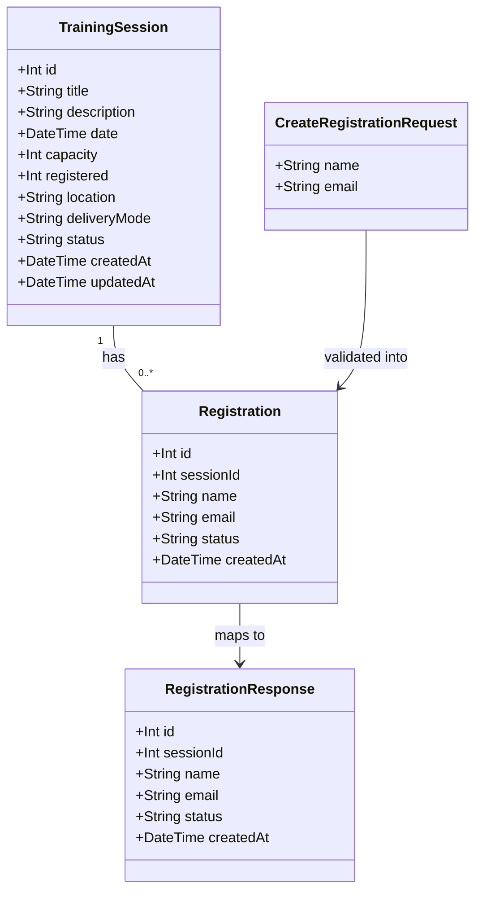

# Employee Registration for an Available Training Session (WH-2)

## Requirements

Implement a registration transaction that lets an employee secure a place in an available training session by submitting their name and email, atomically recording the registration while incrementing the session's occupancy counter, and surfacing the outcome (confirmation, validation failure, or session-full conflict) inline on the existing session card.

Scope and boundaries:

- Extend the existing WorkshopHub three-layer shape (Express route → service → Prisma) with a new `POST /api/training-sessions/:id/registrations` endpoint; no new routes, routers, or architectural layers.
- Persist real `Registration` records so WH-3 (waitlist) and WH-4 (cancellation) can build on them later; the denormalized `registered` counter remains the single source of truth for occupancy.
- Attach the registration form inline on each existing session card; no session detail page, modal, or router is introduced.
- Out of scope: duplicate-registration prevention, waitlist, cancellation, email notification, authentication/SSO, UI test runners.

Value: converts the read-only session catalogue (WH-1) into WorkshopHub's first transactional flow — employees can actually claim seats, and the capacity invariant (`registered <= capacity`) is enforced server-side rather than only displayed.

## Entities



Conservative design notes:

- `TrainingSession` is **unchanged** — no new fields, no derived counts; `capacity`/`registered` stay exactly as they are and continue to serve the list endpoint, admin route, card UI, and seed.
- `Registration` is the **only** new persistence model, with `status` defaulting to `"registered"` to reserve room for WH-3/WH-4 lifecycle states without schema churn.
- `CreateRegistrationRequest` / `RegistrationResponse` are **transport-only shapes** (TypeScript interfaces + inline route payload), not persisted entities; no DTO classes or mapper layers are introduced.
- Relation is declared with `onDelete: Cascade` on the `Registration.session` side so the existing seed's `trainingSession.deleteMany()` keeps working; `TrainingSession` gains only the `registrations Registration[]` back-relation field required by Prisma.

Prisma schema addition (`api/prisma/schema.prisma`):

```prisma
model TrainingSession {
  // ... existing fields unchanged ...
  registrations Registration[]
}

model Registration {
  id        Int      @id @default(autoincrement())
  sessionId Int
  name      String
  email     String
  status    String   @default("registered")
  createdAt DateTime @default(now())
  session   TrainingSession @relation(fields: [sessionId], references: [id], onDelete: Cascade)

  @@map("registrations")
}
```

## Approach

1. **API Design — extend the existing sessions router:**
   - Add `POST /api/training-sessions/:id/registrations` to `api/src/routes/training-sessions.ts`; the route only parses/validates the `:id` parameter, translates service outcomes to HTTP statuses, and writes `{ error: string }` bodies — matching the router's existing translation-only split.
   - Status contract: `201` with registration details; `400` for missing/empty/malformed fields; `404` for a non-numeric `:id` or an unknown session id; `409` when the session is full; `500` with `{ error: 'Failed to register for training session' }` on unexpected failure.
   - Decisions: non-numeric id returns **404** (per resolved answer — deliberately differs from the GET route's 400 and is pinned by its own test); session `status` does **not** gate registration (status remains display-only); the deliberate `$queryRawUnsafe` SQL-injection exercise in `GET /search` is left untouched.

2. **Data Processing — atomic check-and-increment in the service layer:**
   - `createRegistration(sessionId, name, email)` in `api/src/services/trainingSessionService.ts` owns existence check, validation, and the capacity decision; runs the capacity guard and writes inside one Prisma `$transaction`.
   - Atomicity mechanism: `prisma.trainingSession.updateMany({ where: { id, registered: { lt: capacity } }, data: { registered: { increment: 1 } } })` — a single conditional UPDATE whose affected-row count **is** the authorization to insert the `Registration` row in the same transaction. Zero rows affected ⇒ re-check existence to distinguish 404 (missing session) from 409 (full) and abort with no writes.
   - The counter is the only occupancy truth the UI reads, so the registration row and the counter increment commit or roll back together — no read-then-write race, no counter drift.

3. **Business Logic — validation and error handling:**
   - Validation runs **before** any state change: `name` and `email` must be present, and after trimming must be non-empty (empty/whitespace strings count as missing); `email` must match the basic pattern `/^[^\s@]+@[^\s@]+\.[^\s@]+$/`. Violations throw before the transaction opens → `400`.
   - Validation and capacity failures are surfaced as typed error results the route maps to statuses; the endpoint hand-writes its `{ error }` bodies and never falls through to the global Express handler (which leaks stack traces).
   - Duplicates are explicitly allowed (out of scope) — capacity counts *registrations*, not distinct employees.

4. **Frontend — inline card form with refetch-on-success:**
   - `TrainingSessionCard` gains local state: collapsed by default with a "Register" button (disabled/hidden when `registered >= capacity`), expanding to name/email inputs plus submit; a `submitting` flag disables the button while the POST is in flight (double-submit protection, a new pattern for this app).
   - On `201` the card shows a confirmation message and calls a new `onRegistered` callback; `TrainingSessionsPage` refetches `GET /api/training-sessions` so every card renders the authoritative `registered / capacity` (never stale local mutation).
   - Error mapping from status codes to inline card messages: `400` → validation message from the response, `409` → "This session is full", `404` → session not found, network/500 → generic retry message.

5. **Schema delivery and testing strategy:**
   - Apply the schema with `prisma db push` (repo convention; no migrations directory exists) and verify `prisma db seed` still runs clean after adding the relation.
   - Seed gains a purpose-made **full fixture session** (`registered == capacity`, with matching `Registration` rows) so the 409 integration test needs no shared-state mutation; write tests additionally create their own session rows and clean them up (delete created registrations, restore counters) so the shared dev SQLite file is left as found.
   - Tests follow the two existing suites: supertest integration tests in `api/tests/integration/training-sessions.test.ts` for the status-code contract, mocked-Prisma unit tests in `api/tests/unit/trainingSessionService.test.ts` for service logic.

## Structure

### Inheritance Relationships
1. No new interfaces, abstract classes, or inheritance are introduced — the codebase uses plain exported functions in the service layer and Express router handlers, and this story follows that shape exactly.
2. `Registration` is a standalone Prisma model related to (not extending) `TrainingSession`.
3. Frontend `Registration` TypeScript interface (in `app/src/types/index.ts`) is a plain type alongside the existing `TrainingSession` interface.

### Dependencies
1. `POST /:id/registrations` route handler in `training-sessions.ts` calls `createRegistration` from `trainingSessionService.ts`.
2. `createRegistration` depends on the shared Prisma client (`api/src/lib/prisma.ts`) via `findUnique` + `$transaction` (`updateMany` + `create`).
3. `TrainingSessionCard` depends on new props: `onRegistered: () => void` (from the page) and renders the form/confirmation/error from local state.
4. `TrainingSessionsPage` owns the `fetchSessions` function, calls it on mount and again from `onRegistered` after a successful registration.
5. Integration tests depend on `src/app` + the shared SQLite database; unit tests mock `src/lib/prisma` at the service boundary (existing pattern).

### Layered Architecture
1. Controller Layer (Express routes): parse `:id` (non-numeric → 404), parse JSON body, translate service outcomes to 201/400/404/409/500 with `{ error: string }` bodies; no business rules in the route.
2. Service Layer (`trainingSessionService.ts`): input validation (required + trimmed non-empty + email format), session existence check, atomic capacity guard + registration insert inside one transaction; throws typed errors carrying an `error` message and target HTTP status.
3. Repository Layer (Prisma client): `trainingSession.findUnique`, conditional `trainingSession.updateMany`, `registration.create` — no raw SQL anywhere on the new path.
4. Data Access Layer (SQLite via `prisma db push`): `training_sessions` (unchanged) + new `registrations` table with a cascading FK to sessions.
5. Presentation Layer (`app/`): `TrainingSessionsPage` (data ownership + refetch) → `TrainingSessionCard` (inline form, submit, confirmation, inline errors) → existing `TrainingSessionsPage.css` / `TrainingSessionCard.css` for styling.
6. Error Handling: route-level try/catch with hand-written `{ error }` responses; the global handler in `api/src/app.ts` is intentionally not used for this endpoint (it exposes `err.stack`).

## Operations

### Update Schema - `api/prisma/schema.prisma`
1. Responsibility: introduce the persisted `Registration` entity and its relation without altering `TrainingSession`'s existing columns.
2. Add to `TrainingSession` (all existing fields untouched): `registrations Registration[]`.
3. Add new model:
   - `id`: `Int` - `@id @default(autoincrement())`
   - `sessionId`: `Int` - FK to `TrainingSession.id` via `@relation(fields: [sessionId], references: [id], onDelete: Cascade)`
   - `name`: `String` - attendee display name
   - `email`: `String` - attendee email
   - `status`: `String` - `@default("registered")` (lifecycle reservation for WH-3/WH-4)
   - `createdAt`: `DateTime` - `@default(now())`
   - `session`: relation field to `TrainingSession`
4. Table mapping: `@@map("registrations")`.
5. Apply with `pnpm exec prisma db push`, then `pnpm exec prisma generate`.

### Update Seed - `api/prisma/seed.ts`
1. Responsibility: keep seeding green after the schema change and provide the 409 test fixture.
2. Before `prisma.trainingSession.deleteMany()`, add `await prisma.registration.deleteMany()` (explicit, defensive ordering even though the relation cascades).
3. After creating the standard sessions (all `registered: 0`), create one purpose-made full session, e.g. `{ title: 'Full Workshop Fixture', ..., capacity: 2, registered: 2, status: 'active' }`, and two matching `prisma.registration.create` rows with `sessionId` = that session's id, `name`/`email` unique fixture values (e.g. `Fixture Attendee One` / `fixture.one@example.com`), `status: 'registered'`.
4. Verify: `pnpm exec prisma db seed` completes with no errors and `GET /api/training-sessions` still returns the expected shape.

### Create Service Function - `createRegistration` in `api/src/services/trainingSessionService.ts`
1. Responsibility: own validation, existence, and the atomic capacity decision for a registration write.
2. Signature: `export async function createRegistration(sessionId: number, name: string, email: string)` → resolves to the created `Registration` record; rejects with an error object carrying `{ status: number, error: string }`.
3. Logic, in order:
   - **Input validation (before any DB access):** `const trimmedName = name?.trim()`, `const trimmedEmail = email?.trim()`; if either input is `undefined`/`null`/not a string, or either trimmed value is `''`, reject `{ status: 400, error: 'Name and email are required' }`. If `trimmedEmail` does not match `/^[^\s@]+@[^\s@]+\.[^\s@]+$/`, reject `{ status: 400, error: 'Invalid email format' }`.
   - **Existence pre-check:** `prisma.trainingSession.findUnique({ where: { id: sessionId } })`; if `null`, reject `{ status: 404, error: 'Training session not found' }` (avoids a misleading 409 for missing sessions).
   - **Atomic write:** inside `prisma.$transaction(async (tx) => { ... })`:
     1. `const updated = await tx.trainingSession.updateMany({ where: { id: sessionId, registered: { lt: <session.capacity> } }, data: { registered: { increment: 1 } } })` — capture `capacity` from the pre-check result (or re-read inside the transaction via `tx.trainingSession.findUnique` and use that value to avoid a stale capacity).
     2. If `updated.count === 0`: throw `{ status: 409, error: 'Training session is full' }` — the transaction aborts, rolling back any partial work (there is none, but the guarantee holds).
     3. `return tx.registration.create({ data: { sessionId, name: trimmedName, email: trimmedEmail, status: 'registered' } })`.
   - **Failure handling:** let transaction failures propagate to the route's catch → 500; never swallow an insert failure after a successful increment (the transaction boundary prevents this by construction).
4. Constraints: never reads-then-writes the counter outside the transaction; never uses `$queryRaw`/`$queryRawUnsafe`; `status` is always `'registered'` in this story.
5. Annotations: none (plain exported async function, matching `getAllSessions` / `getSessionById`).

### Update Route - `POST /:id/registrations` in `api/src/routes/training-sessions.ts`
1. Responsibility: HTTP translation only — parameter parsing, status-code mapping, response bodies.
2. Handler logic:
   - `const id = parseInt(req.params.id, 10)`; if `isNaN(id)` → `res.status(404).json({ error: 'Training session not found' })` (deliberate: non-numeric id returns 404 on this endpoint, pinned by test).
   - Destructure `{ name, email }` from `req.body` (body may be `undefined`/`{}` — both must still yield 400 via the service's validation).
   - `try { const registration = await createRegistration(id, name, email); res.status(201).json(registration) }`.
   - `catch (error)`: if the error carries a numeric `status`, `res.status(err.status).json({ error: err.error })`; otherwise `console.error('Error creating registration:', error)` and `res.status(500).json({ error: 'Failed to register for training session' })`.
3. Response contract for 201: the full registration record — `{ id, sessionId, name, email, status, createdAt }` (registration details only; the UI refreshes counts by refetching the session list rather than trusting this payload).
4. Registration order in the file: add the handler **after** `router.get('/:id')` is not required (different method), but place it logically with the other `/:id` routes; do not modify the `/search` route.

### Update Frontend Types - `app/src/types/index.ts`
1. Add:
   ```ts
   export interface Registration {
     id: number
     sessionId: number
     name: string
     email: string
     status: string
     createdAt: string
   }
   ```

### Update Component - `app/src/components/TrainingSessionCard.tsx`
1. Responsibility: inline registration interaction and per-card feedback.
2. New props on `Props`: `session: TrainingSession` (existing) + `onRegistered: () => void`.
3. New local state: `showForm: boolean` (default `false`), `name: string`, `email: string`, `submitting: boolean`, `success: boolean`, `formError: string | null`.
4. Render additions (after the existing meta block):
   - If `isFull` and not `success`: render no register button (hidden), keeping the existing `Full` badge.
   - Otherwise, when `!showForm`: a `<button className="session-card__register" onClick={() => setShowForm(true)}>Register</button>`.
   - When `showForm`: a `<form>` with `<input name="name">`, `<input type="email" name="email">`, a Submit button (`disabled={submitting}` with label `Registering...` while in flight), a Cancel button resetting `showForm`/fields/error, `{formError && <p className="session-card__error" role="alert">{formError}</p>}`, and an `aria-live` region.
   - When `success`: `<p className="session-card__success" role="status">You're registered! We'll see you there.</p>` plus a "Register another attendee" button that resets the form state (duplicates are in scope-allowed).
5. Submit handler:
   - `e.preventDefault()`; guard `if (submitting) return`; `setSubmitting(true); setFormError(null)`.
   - `const res = await fetch(`${API_BASE}/api/training-sessions/${session.id}/registrations`, { method: 'POST', headers: { 'Content-Type': 'application/json' }, body: JSON.stringify({ name, email }) })` (import/reuse `API_BASE` via `import.meta.env.VITE_API_URL || ''`, same as the page).
   - `res.ok` → `setSuccess(true)`, `setShowForm(false)`, call `onRegistered()` (page refetches), clear `name`/`email`.
   - Non-ok → parse `{ error }` from the body when possible; map by status: `400` → show server `error` text; `409` → `setFormError('This session is full.')` and close the form (session is full); `404` → `setFormError('Training session not found.')`; anything else → `setFormError('Something went wrong. Please try again.')`.
   - `finally { setSubmitting(false) }`; wrap the fetch in `try/catch` for network failures → same generic message.
6. Styling: add `.session-card__register`, `.session-card__error`, `.session-card__success`, form input/button rules to `app/src/components/TrainingSessionCard.css`, reusing existing badge/button colours and spacing tokens from the current stylesheet.

### Update Page - `app/src/pages/TrainingSessionsPage.tsx`
1. Responsibility: own session data and refresh it centrally after any registration.
2. Extract the existing `useEffect` fetch body into `const fetchSessions = useCallback(() => { ... }, [])` preserving `loading`/`error` semantics (keep initial `loading = true`; the post-success refetch updates `sessions` without re-entering the full-page loading state — set only `setSessions(data)` in the refresh path, or track a `refreshing` flag so the page doesn't flash).
3. Recommended shape: `fetchSessions(initial = false)` — set `loading` only when `initial` is true; call `fetchSessions(true)` in `useEffect` and `fetchSessions(false)` from `onRegistered`.
4. Pass `onRegistered={() => fetchSessions(false)}` to each `<TrainingSessionCard session={session} onRegistered={...} />`.

### Extend Integration Tests - `api/tests/integration/training-sessions.test.ts`
1. Responsibility: pin the HTTP contract and the counter invariant; leave the shared dev database as found.
2. Isolation rules for write tests: every test that creates a registration deletes it in `afterEach`/`afterAll` (`prisma.registration.deleteMany({ where: { email: { startsWith: 'test-…' } } })` style with a unique test email prefix) and restores any session counter it changed; only the seed's dedicated full fixture is used for the 409 case — never mutate a seeded real session's `registered`.
3. Test cases (new `describe('POST /api/training-sessions/:id/registrations')`):
   - **201**: pick a non-full seeded session, `POST { name: 'Test Attendee', email: 'test-attendee@example.com' }` → `expect(res.status).toBe(201)`, body has `id`, `sessionId`, `name`, `email`, `status: 'registered'`, `createdAt`.
   - **Counter increment**: re-`GET /api/training-sessions/:id` → `registered` equals previous + 1; then clean up (delete registration, decrement back) so subsequent tests see the original value.
   - **400 missing fields**: `POST` with `{}` → 400 with `error` defined; also `POST` with `{ name: '   ', email: 'x@example.com' }` → 400 (empty-after-trim counts as missing).
   - **400 invalid email**: `{ name: 'A', email: 'not-an-email' }` → 400.
   - **404 non-numeric id**: `POST /api/training-sessions/abc/registrations` → 404.
   - **404 unknown id**: `POST /api/training-sessions/999999/registrations` → 404.
   - **409 full**: `POST` against the seeded full fixture session → 409 with `error` defined, and a follow-up `GET` confirming `registered` was **not** changed.
4. Assert `{ error }` bodies are present on all non-2xx responses; do not assert on the global handler's shape.

### Extend Unit Tests - `api/tests/unit/trainingSessionService.test.ts`
1. Extend the `jest.mock('../../src/lib/prisma')` factory with `trainingSession: { findMany, findUnique, updateMany }, registration: { create }, $transaction: jest.fn((fn) => fn(mockTx))` where `mockTx = { trainingSession: { updateMany }, registration: { create } }`.
2. Test cases for `createRegistration`:
   - Resolves with the created registration when the conditional update affects 1 row; asserts `updateMany` called with `{ where: { id, registered: { lt: capacity } }, data: { registered: { increment: 1 } } }` and `registration.create` called with trimmed `name`/`email` and `status: 'registered'`.
   - Rejects `{ status: 400, ... }` for missing name, missing email, empty/whitespace name, whitespace email — asserting **no** Prisma method was called (validation precedes any DB access).
   - Rejects `{ status: 400, error: 'Invalid email format' }` for malformed email, again with zero Prisma calls.
   - Rejects `{ status: 404, ... }` when `findUnique` returns `null`.
   - Rejects `{ status: 409, ... }` when `updateMany` returns `{ count: 0 }` for an existing session, and asserts `registration.create` was **not** called.
3. `afterEach(() => jest.clearAllMocks())` per the existing file.

### Execution Order
1. Prisma schema + `db push` + `generate` → 2. seed fixture → 3. service function → 4. route handler → 5. frontend types → 6. card component + CSS → 7. page refetch wiring → 8. unit tests → 9. integration tests → 10. run `pnpm test`, seed, and manually verify the register flow in the browser.

## Norms

1. **Annotation/typing standards**: no decorators anywhere — plain exported async functions in the service layer, Express router handlers with explicit `(req: Request, res: Response)` types, and `interface` types on the frontend (`Props`, `Registration`). All new frontend props are required and typed; no `any`.
2. **Dependency injection**: continue importing the singleton Prisma client from `api/src/lib/prisma.ts` (never instantiate a new `PrismaClient` in src); unit tests mock that module path exactly as the existing suite does.
3. **Exception handling**:
   - Service-layer failures are plain `Error`-compatible objects carrying `{ status: number, error: string }`; the route is the only place that maps them to HTTP.
   - Error bodies are always `{ error: string }` — the format every existing route already returns.
   - Error messages are user-safe: no stack traces, no SQL, no Prisma internals; unexpected failures log via `console.error` with a generic client message.
   - All new endpoint failures are handled inside the route handler; never rely on the global handler in `app.ts` (it exposes `err.stack`).
   - No new custom exception class hierarchy is introduced — the codebase has none, and adding one would be unnecessary refactoring for a single endpoint.
4. **Data validation**: validate in the service before any write; trim then check non-empty for required strings; `/^[^\s@]+@[^\s@]+\.[^\s@]+$/` for basic email format; `parseInt(..., 10)` + `isNaN` for route params; never trust client-side disabled-button state.
5. **Write integrity**: all multi-statement writes go through `prisma.$transaction`; occupancy changes use conditional `updateMany` with `increment`, never read-then-set; no `$queryRaw`/`$queryRawUnsafe`/string-built SQL on any new code path.
6. **Logging**: `console.error('Error <action>:', error)` in route catch blocks, mirroring `Error fetching training sessions:`; no logging of attendee email contents.
7. **Documentation/comments**: comment only non-obvious intent (e.g. why the counter uses a conditional update, why non-numeric id returns 404 here, why the seed fixture exists); keep the existing file header/schema comment conventions; no JSDoc boilerplate on trivial functions.
8. **Styling**: extend existing CSS class naming (`session-card__*`, BEM-ish suffixes) and reuse current colour/spacing variables; no new CSS framework or inline style objects.
9. **Testing conventions**: Jest + supertest for integration, mocked-Prisma for unit, `expect(response.body.error).toBeDefined()` on error statuses, and shared DB writes are always cleaned up.

## Safeguards

1. **Functional Constraints**:
   - `POST /api/training-sessions/:id/registrations` returns exactly: 201 `{ id, sessionId, name, email, status, createdAt }` on success; 400 for missing/empty/whitespace-only `name` or `email` and for malformed email; 404 for non-numeric `:id` and for unknown session ids; 409 when `registered >= capacity`; 500 `{ error: 'Failed to register for training session' }` otherwise.
   - `registered` increments by exactly 1 per successful registration and never exceeds `capacity`.
   - The register button is hidden when the session is full and disabled while a request is in flight; client-side guards are convenience only — the API must independently enforce 400/404/409.
   - On success, a confirmation message is shown and the session list is refetched so displayed counts are server-authoritative.
   - Session `status` does **not** gate registration in this story; duplicate registrations are **allowed**.
2. **Performance Constraints**: the write path is one existence read plus one transaction (conditional update + insert) — no full-table scans, no `COUNT(registrations)` on read paths; the list endpoint's existing behaviour and payload shape must not change measurably.
3. **Security Constraints**: no raw SQL on the new path; never modify the intentional `$queryRawUnsafe` exercise in `GET /search`; responses must not include stack traces, Prisma error details, or SQL; attendee name/email are stored as provided (trimmed) and never interpolated into queries.
4. **Integration Constraints**: `pnpm exec prisma db push` must apply cleanly on a fresh and an existing dev DB; `pnpm exec prisma db seed` must complete without error after the schema change (registration rows deleted before sessions); existing GET endpoints, admin routes, and the frontend's session-list contract must remain byte-compatible for current consumers.
5. **Business Rule Constraints**: full ⇔ `registered >= capacity` evaluated against the stored counter (the counter is the capacity truth, not a row count); validation failures occur before any state change; a rejected (400/404/409) request must leave `registered` and the `registrations` table untouched.
6. **Exception Handling Constraints**: every non-2xx response from the new endpoint is `{ error: string }` with a user-safe message; the endpoint must never fall through to the global error handler; unexpected errors log server-side and return a generic 500 body.
7. **Technical Constraints**: no new architectural layers, routers, DI containers, or state libraries; no session detail page/modal/router; no changes to the `TrainingSession` columns or the existing service function signatures; no `any` types in new frontend code; UI double-submit protection via the `submitting` flag.
8. **Data Constraints**: `Registration` fields are `sessionId` (required FK), `name`/`email` (required, trimmed non-empty, email basic format), `status` default `'registered'`, `createdAt` server-generated; FK cascades on session delete; no unique constraint on `email` (duplicates allowed by scope).
9. **API Constraints**: endpoint path is exactly `POST /api/training-sessions/:id/registrations` under the existing router mount; request body is `{ name: string, email: string }`; responses are JSON with the statuses above; no new API versioning, pagination, or content negotiation.
10. **Test & Environment Constraints**: integration tests must leave the shared dev SQLite database as found (delete created registrations, restore mutated counters, use the seed's dedicated full fixture for 409); the deliberate SQL-injection exercise and other Workshop seed vulnerabilities must remain untouched; only `api/tests/` suites are extended — no UI test-runner work in `app/`.
